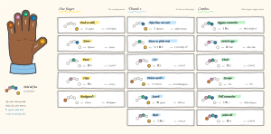

# handful

Your whole workflow, in a handful of keys.

These days I do a lot of my work by voice: tap a shortcut, speak, tap it
again. The rest is a few familiar moves, like copy, paste, undo a word or grab
a screenshot. handful puts those moves under one hand, so I can lean back with
the other on the mouse. Each button sends a key on its own, and pressing
several together (a chord) sends more: 4 buttons give 15 actions, 5 give 31.
It shows up as a normal USB keyboard, so the computer needs no drivers.

## What it is

- A small one-handed keypad with five buttons, one per finger and one for the
  thumb.
- A chording keyboard: any combination of buttons pressed together is its own
  action.
- Built for a voice-first workflow: push-to-talk, enter, copy, paste,
  backspace and screenshots are the moves that matter most.
- Runs on a Raspberry Pi Pico, which acts as a standard USB keyboard.
- Buttons and mappings are configurable.

## Chords



There's also a printable [cheat sheet](docs/cheatsheet.svg).

## Status

The firmware runs on a breadboard prototype with five tactile buttons. The
current design is in [`docs/architecture.md`](docs/architecture.md), and each
accepted decision is in [`docs/decisions/`](docs/decisions/).

## Getting started

1. Install [CircuitPython](https://circuitpython.org/board/raspberry_pi_pico/)
   on a Raspberry Pi Pico and wire the buttons as in
   [0008](docs/decisions/0008-direct-gpio-wiring.md). For a mode light on the
   shell, add the RGB LED from
   [0018](docs/decisions/0018-rgb-indicator-led.md).
2. Plug the Pico in and run `python3 tools/deploy.py`. The firmware uses only
   modules built into CircuitPython, so nothing is downloaded.
3. Edit `mappings.py` on the CIRCUITPY drive to change what each chord does.
   The LED is on in macOS mode and off in Windows mode (the RGB LED is green
   and blue); hold all five buttons to switch.
4. Print the [cheat sheet](docs/cheatsheet.svg).

## Tuning the layout

handful can count how often you use each chord, so the busiest ones can move
to the easiest spots. It keeps totals only, never what you typed or when.

1. Set `COUNT_CHORDS = True` in `mappings.py` on the CIRCUITPY drive.
2. Use handful as usual for a week or two.
3. Run `python3 tools/usage.py` (with pyserial installed, as in Development)
   to see every chord ranked, the mapped chords not used yet and the unmapped
   chords pressed anyway.
4. Swap the chords where the gain is clear, then set `COUNT_CHORDS = False`
   again. Counting saves to the Pico's flash once a minute, so it's meant for
   short tuning rounds. `python3 tools/usage.py --reset` starts a fresh round.

## Development

Use Python 3.13 or newer in a virtual environment, as CI does:

```sh
python3.13 -m venv .venv
source .venv/bin/activate
pip install -r requirements-dev.txt
```

Then:

- `python3 tools/cheatsheet.py` redraws the cheat sheet and the chords above
  after `firmware/mappings.py` changes.
- `ruff check .` lints the code.
- `coverage run -m unittest discover -s tests && coverage report` runs the
  tests on the computer and checks that they cover at least 90% of the code.

GitHub Actions runs the lint and the tests on every pull request.

## Inspiration

handful borrows ideas, not code, from
[ARTSEY](https://artsey.io/), GKOS, the Twiddler,
[tobychui/4xMacropad](https://github.com/tobychui/4xMacropad) and the combo
features of [QMK](https://qmk.fm/) and [KMK](https://github.com/KMKfw/kmk_firmware).

## Licence

[MIT](LICENSE)
