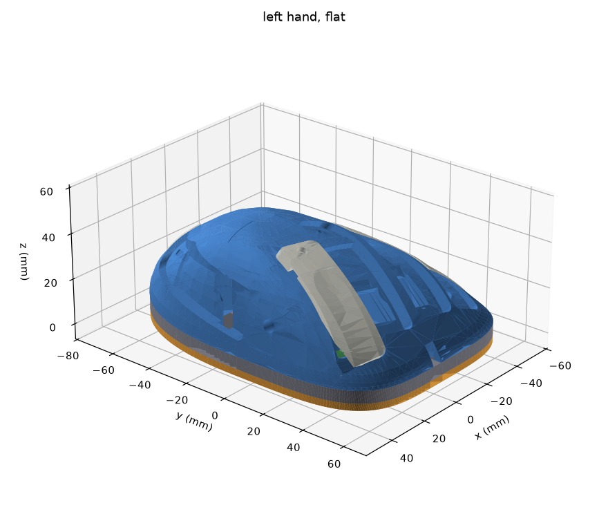
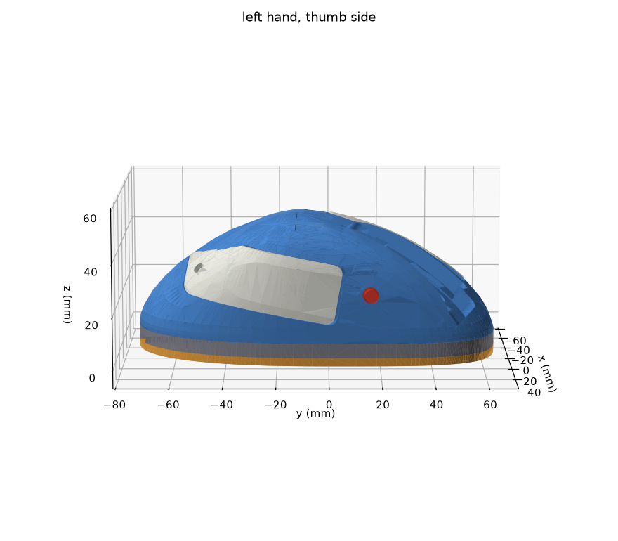
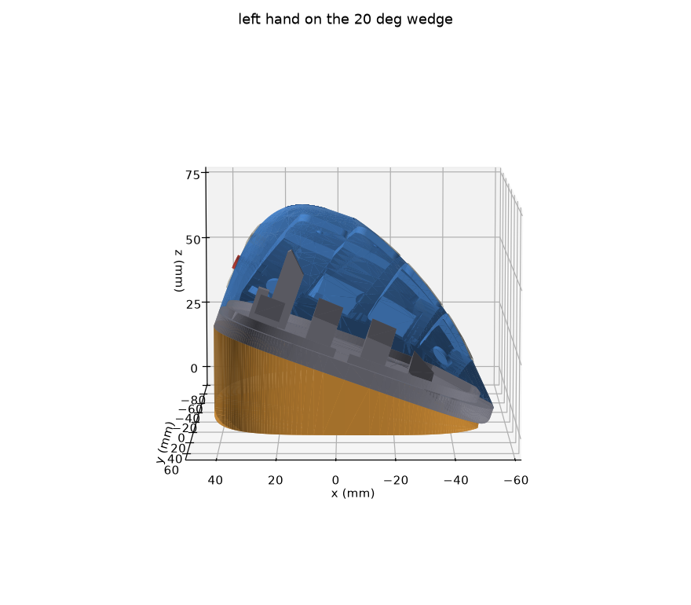
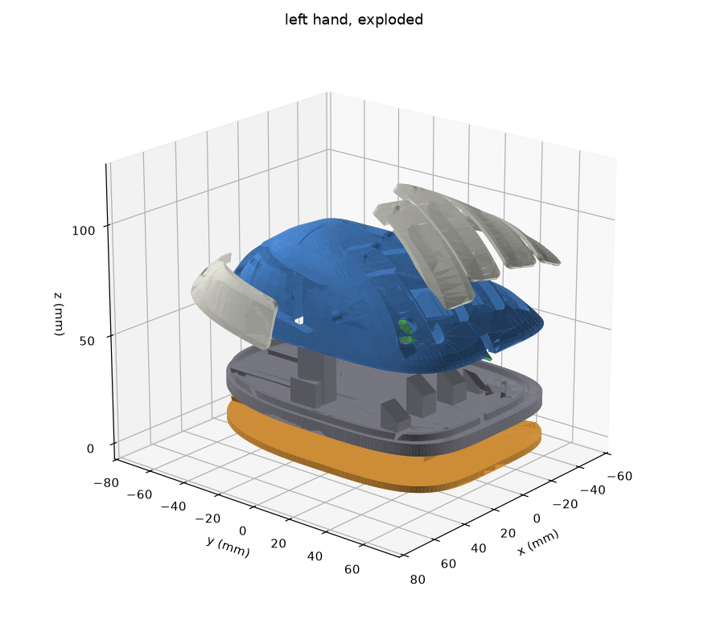
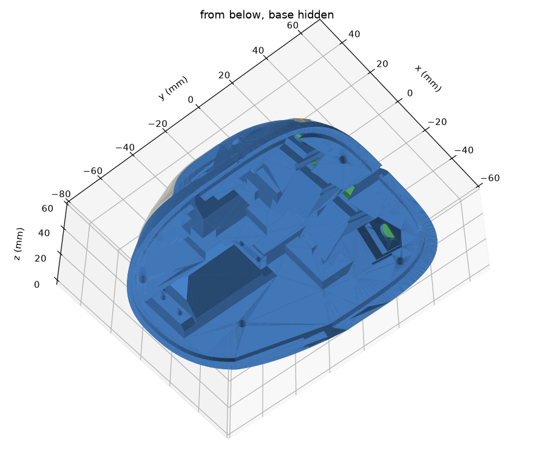
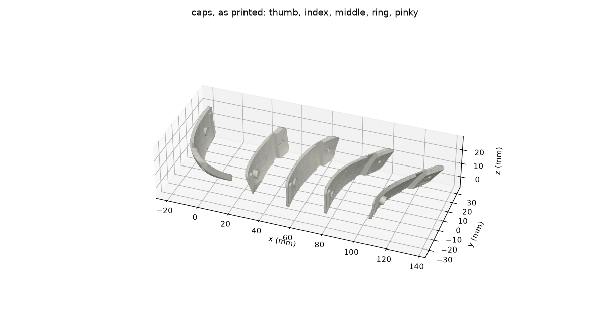
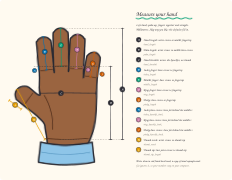

# handful grip shell CAD

Parametric [build123d](https://github.com/gumyr/build123d) scripts for the
grip shell in [0011](../docs/decisions/0011-grip-shell.md). The shell is
shaped like a palm-supported mouse after the Logitech MX Ergo: it is highest
under the index knuckle and slopes gently down to the desk on the pinky side
and at the back, so the hand rests on the shell and the desk at once. The
thumb key is on the side and the four finger keys fan out across the front.
Every key is a long cap, flush with the surface, that runs along its digit
and bends on a printed hinge at its back end, so the whole hand rests on the
shell and just presses. The caps and the finger layout are in
[0021](../docs/decisions/0021-long-hinged-caps-and-fanned-fingers.md).
The shell is solid, with a cavity for each part inside. The parts and how they
join are in
[0017](../docs/decisions/0017-grip-shell-parts-and-fastening.md); the choice
of build123d is in [0016](../docs/decisions/0016-build123d-cad.md).








The renderer draws parts back to front, so some finger caps hide behind the
shell in these previews; open the STL files in a slicer to see every part.

## Build

Use Python 3.13 in its own virtual environment (the CAD kernel is large and
separate from the firmware tools):

```sh
cd cad
python3.13 -m venv .venv
.venv/bin/pip install -r requirements.txt
.venv/bin/python build.py              # left hand
.venv/bin/python build.py --hand both  # left and right
```

Each hand takes about two minutes and writes to `build/<hand>/`:

- `shell`, `base`, `key_module`, `cap_thumb` …
  `cap_pinky` and
  `wedge_00` … `wedge_20`, each as `.stl` for the slicer and `.step` for other
  CAD tools;
- `hinge_test`, `hinge_test_base` and `hinge_test_cap_0_6mm` …
  `hinge_test_cap_1_0mm`, a small test of the cap hinge (see Print);
- `tactile_adapter`, which holds a 12 × 12 mm tactile button in a key module
  instead of a Choc switch, to try the grip with the prototype's buttons (see
  Assemble);
- `insert_test` and `insert_test_plate`, a quick test of the inserts and
  screws (see Print);
- `assembly_00.step` and `assembly_20.step`, the parts in place;
- `renders/*.png`, shaded previews.

`build/` is not committed: rebuild it from the scripts, so the files always
match the source. A left-hand build also refreshes `previews/`, which is
committed so the design shows on GitHub.

The slow parts (shell, base, caps, the pinky's module and the hinge test
slices) are kept in `build/cache/` as BREP files, filed under the CAD source
and each part's arguments (all the parameters, the hand and the key). The
tests and `build.py` share them, and each run keeps every part it builds in
memory too, so the renders reuse them. A part built once for a set of
parameters, such as your hand's or the default, loads from its file after
that; changing a parameter or editing `handful_cad/` builds it again. `python build.py --no-cache` (or
`HANDFUL_CACHE=0`) skips the files.

Run the checks with `.venv/bin/pytest`. It builds each missing part once, on
every core, and runs the tests in parallel (`pytest.ini`).
They build every part for both hands and check that each is one closed solid,
that the switch cutout takes a 14 mm Choc switch in a 1.3 mm plate, that the socket is
held against the switch, that every cap's top over its switch sits `cap_proud` less the dish, presses until its
stop pad lands without touching the shell, its switch or a
neighbour, and lines up with its screw insert, that the hinge test slices
match the real shell and base and each test cap presses fully in them, that
the Pico, wires, status LED with its leads, and the USB plug clear everything,
that each
module stops on its seat and is held there by a post or the thumb block, that
the inner cavities and screw holes keep solid walls, that each wedge fits the
base and prints without supports, and that the cable stays level at every
tilt.

## Change the design

Every dimension is in [`handful_cad/params.py`](handful_cad/params.py), with
its source. Change a default there, or build a variant in Python:

```python
from handful_cad import parts
from handful_cad.params import DEFAULT

params = DEFAULT.with_(hand="right", hand_breadth=88.0, wedge_angles=(0, 15, 25))
shell = parts.shell(params)
```

- **Hand size**: `hand_length`, `hand_breadth` and `palm_length` default to
  the midpoint of the ANSUR II male and female means (187.2, 83.3 and
  112.6 mm), a medium adult hand. To fit your own hand, copy
  [`hand.example.toml`](hand.example.toml) to `hand.local.toml`, fill in your
  measurements and build with `build.py --params hand.local.toml`. Git
  ignores `*.local.toml` and `build/`, and a `--params` build leaves
  `previews/` alone, so your measurements stay on your computer. Every
  measurement is optional; the ones you skip keep their defaults. The
  `[hand]` table takes the measurements and `[params]` any other parameter
  below. To run the tests against your hand, set
  `HANDFUL_PARAMS=hand.local.toml`.

  

  Redraw the guide with `python3 tools/hand_guide.py` from the repository
  root.
- **Shape**: `body_squareness` (higher is squarer seen from above),
  `body_crown` (higher is flatter on top), `body_crest_shift` (how far the
  crest sits towards the thumb), `body_pinky_extra` and `body_pinky_crown`
  (a wider, gentler pinky side), `body_pinky_flare` and
  `body_pinky_flare_height` (the concave foot of the pinky side),
  `body_rear_extra`, `body_rear_crown` and `body_rear_squareness` (a longer,
  gentler, rounder back), `body_front_crown` (lower is a longer, straighter
  front ramp for the fingers), `body_height` and the margins.
- **Screws**: `boss_angles` places the four M3 screws round the outline
  (thumb front, pinky front corner, pinky back, thumb back), and
  `boss_insets` sets each one's distance inside the inner wall; a screw
  slides along the outline to clear the cavities and key wells.
- **Locating rim**: `locating_lip_height`, `locating_lip_width`,
  `locating_lip_inset` and `locating_lip_boss_gap` for the wall on the base
  that guides the shell into place. `locating_lip_roof` sets how far above
  the groove the inset is measured, so a flared side keeps skin over it.
- **Key positions**: `fingertip_spacing` (fingertip pads apart, centre to
  centre: index–middle, middle–ring, ring–pinky; the fingers fan out to them
  within the body's width and shrink in proportion if they don't fit),
  `finger_offset_x`, `key_reach`, `heel_overhang`, `thumb_reach` (wrist
  crease to thumb tip) and `thumb_z`. `cap_slant` turns each finger key
  and its switch about the fingertip (10° by default), so the palm end
  swings towards the pinky and the hand leans onto the rounded heel;
  `thumb_back` and `thumb_cap_tilt` move the thumb tip back and tilt its cap
  to follow the turned hand. `switch_lean` rolls a finger's switch about
  its finger, out towards where the shell falls away (18° for the pinky, so
  its housing clears the cap wrapping down that side), and `switch_shift`
  moves a module across its finger (ring −3.5 mm, pinky −2 mm, towards the
  thumb) so the modules fit side by side above the base's floor.
- **Caps**: `cap_widths` (thumb to pinky), `cap_pip` (a finger cap's length
  as a share of the finger, tip to middle joint), `thumb_tip_length` and
  `thumb_proximal` (the thumb cap's length), `cap_proud` and `cap_gap`.
  Where the shell rolls away across a cap, the cap wraps round towards its
  opening's floor, which sits `cap_roll` (`thumb_cap_roll` for the thumb)
  below the opening's centre line. The cap stays a `clearance` above that
  floor all the way through its press, so it gives up width only where its
  travel needs the room. A larger roll sets the switch deeper; the pinky's
  is the one that reaches the base floor. A stop pad under each pad's
  fingertip end, `stop_pad_length` long, lands on the opening's floor once
  the stem has moved `cap_stop` (2.5 mm, past the 1.3 ± 0.3 mm actuation),
  so the cap needs less room to swing and keeps more of its width. Keys listed
  in `own_module_keys` (none by default) get their own module whose lip
  gives up the corner the cap's side swings past. The pad's
  top is dished `cap_dish` (0.8 mm) along its centre line so the finger
  settles into it; the dish fades out over `cap_dish_fade` before the
  hinge. The
  hinge: `flexure_length`, `flexure_thickness` (0.8 mm, two nozzle lines),
  `flexure_room` and
  `anchor_length`; `hinge_test_flexures` lists the test caps' thicknesses.
  `thumb_screw_shift` moves the thumb cap's M2 screw (and its insert) down
  the side wall and towards the hinge, into the solid part of the tab where
  the side curves over into the top.
- **Tilt**: `wedge_angles` lists the wedges to print (0°, 10° and 20°).
  Wedges up to 30° print without supports.
- **Rounded heel**: under the wrist and the pinky side of the palm the
  underside curves up with `heel_radius` until it rises at `heel_angle`
  (20°, the steepest wedge), so that corner rests on the desk on every
  wedge. `heel_front` and `heel_back` place the line where the curve starts;
  the base and wedges stop there. On a steeper wedge the heel stays
  `heel_clearance` above the desk; raise `heel_angle` to match it.
- **Fit**: `clearance` (0.2 mm) sets sliding fits; `hole_clearance` (0.1 mm)
  is added to the switch cutout; `post_gap` (0 mm) sets where each post and the
  thumb block meet their module: positive leaves a gap, negative presses
  harder. If a module rattles after a test print, lower it or add a thin
  foam pad on the post; if the base won't close, raise it.
- **Status LED**: `led_size` (body, flange and length of a 5 mm RGB LED)
  sizes its hole; `led_ahead_of_thumb` and `led_z` place it just ahead of
  the thumb tip, and `led_wiring_room` sizes the bay behind it for its
  leads.

## Print

- 0.4 mm nozzle, 0.2 mm layers, PLA or PETG, 3 walls, 15–20 % infill.
- Every STL is exported in its print orientation, so load it as it is:
  - **shell**: on its flat bottom, top up. This keeps every outer surface,
    where the hand rests, clean. The rounded heel underneath needs supports
    from the build plate only. The cavities inside have
    vertical walls, 45° roofs or short bridges (9 mm over the thumb module,
    13 mm over the USB plug, 21 mm for the Pico's two bridges). The finger modules' 5 mm seat ledges lean 27°
    and may sag slightly, which only seats the module a little lower. Use
    3–4 walls so the screw holes and seats are solid;
  - **base**: flat on its bottom, posts up. The dovetail grooves underneath
    are short bridges; the edge along the rounded heel needs supports from
    the build plate only;
  - **key modules** (print 5 `key_module`): each
    leaning on its end, standing on the plate's lip and the floor's edge with
    the plate at about 58° to the bed. No supports, so the plate prints
    smooth, ready for the switch. A module touches the bed along two edges,
    so add a brim (about 5 mm);
  - **caps**: on their side, in PETG, so the flexure's layers run along the
    strip and it bends without splitting. They touch the bed along a narrow
    edge, so add a brim (about 5 mm);
  - **wedge**: flat on its bottom, no supports.
  - **tactile adapter** (print 5, if you use it): plug down, no supports.
- Print the insert test first, about 20 minutes: `insert_test` (holes up)
  and `insert_test_plate` (counterbores up), both flat. The block has three
  M2 holes along the front and three M3 holes along the back, 0.1 mm under,
  at and 0.1 mm over `m2_insert_hole` and `insert_hole`, smallest at the
  notched corner. Press an insert into each with the soldering iron. The
  right hole takes the insert only when hot, and the insert doesn't pull
  out when cold. Then screw the plate on: its thin half is a cap's tab
  (M2 × 4 screws) and its thick half the base (M3 × 8 screws). Each screw
  head should sit below the surface and grip without bottoming out. If another hole fits
  better, change the parameter by 0.1 mm.
- Then print the hinge test: `hinge_test` (a slice of the real shell round
  the middle key, rim-down), `hinge_test_base` (the base under it, flat),
  one key module and the three `hinge_test_cap_*` middle caps, with 0.6, 0.8
  and 1.0 mm flexures. Fit the module and a switch, set the slice on the base
  slice on the desk, screw a cap on with an M2 insert and screw, and press it
  many times. Check that the switch clicks in firmly, the socket slides
  snugly into its channel, the cap presses fully and springs back, and the
  strip doesn't crack. Set `flexure_thickness` to the best one, and adjust
  `hole_clearance` if the switch is loose or tight.

## Parts to buy

- 5 Kailh Choc v2 low-profile switches (PG1353), light ones (each cap stops
  at 2.5 mm of travel); see
  [0023](../docs/decisions/0023-choc-v2-low-profile-switches.md)
- 5 Kailh Choc hot-swap sockets (CPG135001S30)
- Raspberry Pi Pico and a micro-USB cable. Its plug's moulding must fit in
  12.5 × 8.5 mm and 30 mm long, with a cable up to 4.5 mm thick. For a
  bulkier cable, measure it and set `usb_plug_size`, `usb_plug_length` and
  `usb_cable_diameter` under `[params]` in your hand file
- 9 M2 heat-set inserts (M2 × 4, about 3.0 mm across the knurls): 4 for the
  Pico and 5 for the caps. For other inserts, set `m2_insert_hole` 0.4 mm
  under their knurl diameter, so they only go in hot
- 9 M2 × 4 mm socket-head screws (ISO 4762): 4 for the Pico and 5 for the
  caps, whose heads sit in counterbores
- 4 M3 heat-set inserts (M3 × 6, about 4.5 mm across the knurls) and 4 M3 ×
  8 mm socket-head screws, sunk in counterbores in the base
- One 5 mm 4-leg common-cathode RGB LED and a 330 Ω resistor, as in
  [0018](../docs/decisions/0018-rgb-indicator-led.md)
- Thin stranded wire

## Assemble

1. With a soldering iron, press the M3 inserts into the four holes in the
   shell's bottom face, an M2 insert into the hole at the back end of each cap's opening
   and the other M2 inserts into the four holes in the bridges across the
   Pico's bay, at the back of the shell.
2. Solder a wire to each tab of every hot-swap socket, then slide each socket
   into its key module's channel until it lines up with the switch holes.
3. Clip a switch into each module. Turn the shell upside down and push each
   module into its cavity from below, switch first, until its lip stops on
   the seat. Lead the socket wires along the channels to the Pico's bay.
4. Push the status LED into its hole just ahead of the thumb key from the
   bay inside, until its flange stops. Solder a wire to each leg and lead
   them down to the main cavity.
5. Lay the Pico upside down in its bay, components towards you and USB to
   the front, between the bridges' chamfers, and screw it up into the
   bridges with four M2 × 4 screws. Keep the solder off the back of pins 1,
   2, 19–22, 39 and 40, under the bridges, so the board sits flat. Plug in
   the USB cable. Wire each switch
   between its GPIO pin and GND as in
   [0008](../docs/decisions/0008-direct-gpio-wiring.md). Wire the LED as in
   [0018](../docs/decisions/0018-rgb-indicator-led.md): blue to GP26 (pin
   31), green to GP27 (pin 32), red to GP28 (pin 34), and the common leg
   through the resistor to GND (pin 38). Everything is now in the shell,
   so plug the cable into a computer and test every key and the LED before
   closing it.
6. Lay the cable in the groove that runs from the Pico's bay to the front of
   the shell. Fit the base's rim into the groove inside the shell's edge,
   checking that the four posts and the thumb block meet their
   modules, and screw it on from below. The posts and block press every
   module into its seat, and a rib on the block stops the thumb module
   dropping. The cable stays plugged in: to swap it, open the base.
7. Lay each cap in its opening, its pusher on the switch stem, and screw its
   tab down with an M2 × 4 socket-head screw.
8. Slide a wedge onto the base from the back until it stops.

To try the grip with 12 × 12 × 7 mm tactile buttons before the Choc switches
arrive, use a tactile adapter in each key module instead of the switch and
socket. The button sits partly below the plate, so first cut its legs to
1 mm below the body (`tactile_leg_cut`). Solder a wire to one leg of each pair (legs on opposite sides of the
button), thread the wires down through the module's socket holes and out of
its channel, set the button in the adapter's cup and push the adapter's plug
into the module's switch hole. The yellow actuator then sits 0.1 mm under
the cap's pusher (`tactile_gap`), where a Choc stem's top would be. The button
travels about 0.25 mm, so each key moves very little. Measure your buttons:
`tactile_height` is the body's underside to the actuator's top. To change to
Choc, push the adapter out from below through the hole under the button.

## Sources

The datasheets behind each number are listed at the top of
[`handful_cad/params.py`](handful_cad/params.py): the Kailh Choc v2
PG135301D03 and Choc socket CPG135001S30 drawings, the Omron B3F tactile switch datasheet, the Raspberry Pi Pico datasheet, Kingbright's 5 mm RGB LED drawing, CNC Kitchen's heat-set insert guidance, the Logitech MX
Ergo specifications and the ANSUR II survey (Gordon et al., 2014). Values
marked ASSUMPTION there have no primary source and are worth checking against
your parts.
