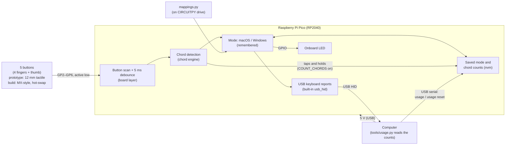
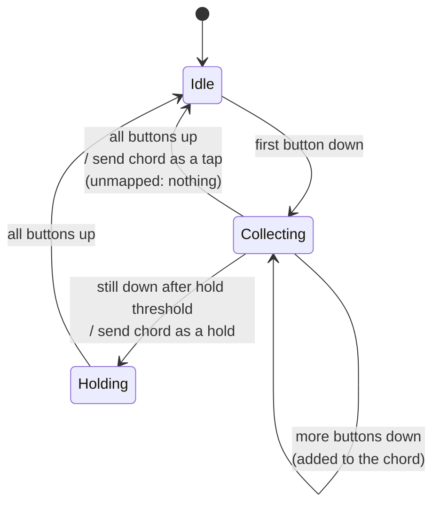

# Architecture

## Overview

handful is a one-handed chording keypad. A Raspberry Pi Pico reads five
buttons, one per finger and one for the thumb, turns single presses and chords
into key presses, and sends them to the computer as a USB keyboard. It holds a
macOS and a Windows mapping set and switches between them with a chord. The
firmware is written in CircuitPython.

## Diagram

### Chord detection

## Components

- **Raspberry Pi Pico (RP2040)**: the only microcontroller. See
  [0001](decisions/0001-raspberry-pi-pico.md).
- **Five buttons**: one per finger and one for the thumb, giving 31
  combinations. See [0003](decisions/0003-five-buttons.md).
- **Switches**: 12 × 12 mm tactile push buttons on a breadboard for the
  prototype; MX-style switches in hot-swap sockets, hand-wired in a
  3D-printed shell, for the finished keypad, with a weight chosen per
  finger by testing. See [0007](decisions/0007-switches.md) and
  [0010](decisions/0010-mx-style-switches.md).
- **Enclosure**: a 3D-printed grip shell inspired by the Logitech MX Ergo,
  for the left hand first and mirrorable, tilted by swappable printed wedges
  from 0° to 30° and beyond. See [0011](decisions/0011-grip-shell.md).
- **CircuitPython firmware**: reads the buttons, detects chords and sends key
  presses through the built-in `usb_hid` module, with no downloaded libraries.
  See [0013](decisions/0013-circuitpython-with-built-in-modules-only.md).
- **Mapping modes**: a macOS set and a Windows set, toggled by holding all
  five buttons. The onboard LED shows the active mode, and the mode survives a
  power cycle. See [0004](decisions/0004-macos-and-windows-modes.md).
- **Chord detection**: every button pressed until all are released forms one
  chord, sent on release. A chord held past the hold threshold (400 ms by
  default) is sent as a hold instead. See
  [0005](decisions/0005-chords-fire-on-release.md).
- **`mappings.py`**: the macOS and Windows mapping sets, kept on the CIRCUITPY
  drive apart from the firmware. Errors are reported with the LED and the
  serial console. See [0006](decisions/0006-mappings-py.md).
- **Default layout**: single presses for push-to-talk, enter, paste, copy and
  backspace; thumb chords for their variants; more fingers for bigger actions.
  Most actions fire once when held; backspace and delete word repeat. Holding
  all five toggles the mode; unmapped chords do nothing, so adding the
  remaining fingers cancels. See [0009](decisions/0009-default-mappings.md).
- **Chord usage counts**: with `COUNT_CHORDS = True` in `mappings.py`, the
  Pico counts how often each chord is tapped and held, with no order or
  times, and saves the totals to nvm at most once a minute. Off by default to
  spare the flash. `tools/usage.py` reads and clears them over serial. See
  [0014](decisions/0014-opt-in-chord-usage-counts.md).

## Firmware layout

The firmware lives in `firmware/` and is copied to the CIRCUITPY drive with
`tools/deploy.py`, which downloads nothing, removes files the firmware no
longer has and leaves an existing `mappings.py` in place.

- `code.py`: starts the app on the Pico.
- `mappings.py`: timings, the mode chord, the `COUNT_CHORDS` switch and
  both mapping sets. Key names such as `CMD+SHIFT+4` are read by the
  firmware, so the file needs no imports.
- `handful/` chord engine, plain Python with no hardware imports, tested on
  the computer (see Development in the README):
  - `debounce.py`: per-button debounce.
  - `chords.py`: tap, hold and repeat events.
  - `keypad.py`: turns events into key presses for the active mode and
    toggles the mode.
  - `usage.py`: the chord usage counts and their saved form.
  - `config.py` and `keys.py`: read and check `mappings.py`, and turn key
    names into USB HID usage IDs. `config.BUTTONS` sets the button order
    everywhere.
  - `app.py`: the main loop. It loads `mappings.py`, feeds button reads to
    the keypad, sends keys, retries a release when USB is busy, saves the
    usage counts and answers `usage` and `usage reset` on the serial
    console. It gets the board passed in, so tests run it with a fake board.
  - `hid.py`: builds USB keyboard reports.
- `handful/pico.py` board layer: button pins, the LED, the USB keyboard
  device, serial console input, and the saved mode (byte 0) and usage counts
  (after it) in `microcontroller.nvm`. Tests run it with stand-ins for the
  CircuitPython modules.

`tools/cheatsheet.py` draws the printable [cheat sheet](cheatsheet.svg) and
the README [chords banner](chords.svg) from `mappings.py`, naming each action
after the comment on its line. The drawing code is in `tools/drawings/`. Both
drawings embed Permanent Marker and Coming Soon (Apache-2.0, in
`tools/drawings/fonts/`), cut down to the letters they use, so they look the
same on every computer. A test fails when either drawing is out of date.

`tools/usage.py` asks the Pico for its chord counts over the serial console
and prints them ranked, with the mapped chords not used yet and the unmapped
chords pressed anyway. `--reset` clears them.

The LED is on in macOS mode, off in Windows mode, and blinks fast when
`mappings.py` has a problem. A held repeating action fires once at the hold,
then after another 400 ms repeats every 50 ms, like a normal keyboard.

## Interfaces

- Buttons to Pico: each button between its own GPIO and GND, internal
  pull-ups, active low, 5 ms debounce. Thumb GP2, index GP3, middle GP4,
  ring GP5, pinky GP6. See [0008](decisions/0008-direct-gpio-wiring.md).
- Pico to computer: a USB cable carrying a HID keyboard, no drivers needed,
  and CircuitPython's serial console, where the firmware reports problems and
  answers `usage` and `usage reset`.
  The firmware keeps the chord engine and mappings apart from a board layer
  (pins, LED, HID), so a wireless board can be added later. See
  [0012](decisions/0012-wired-usb.md).

## Power

The Pico is powered from the computer over USB. No battery.

## Not decided yet

- CAD tool for the shell, chosen after the prototype.
