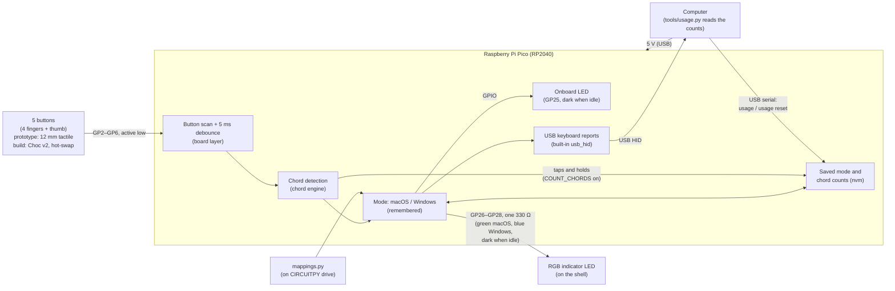
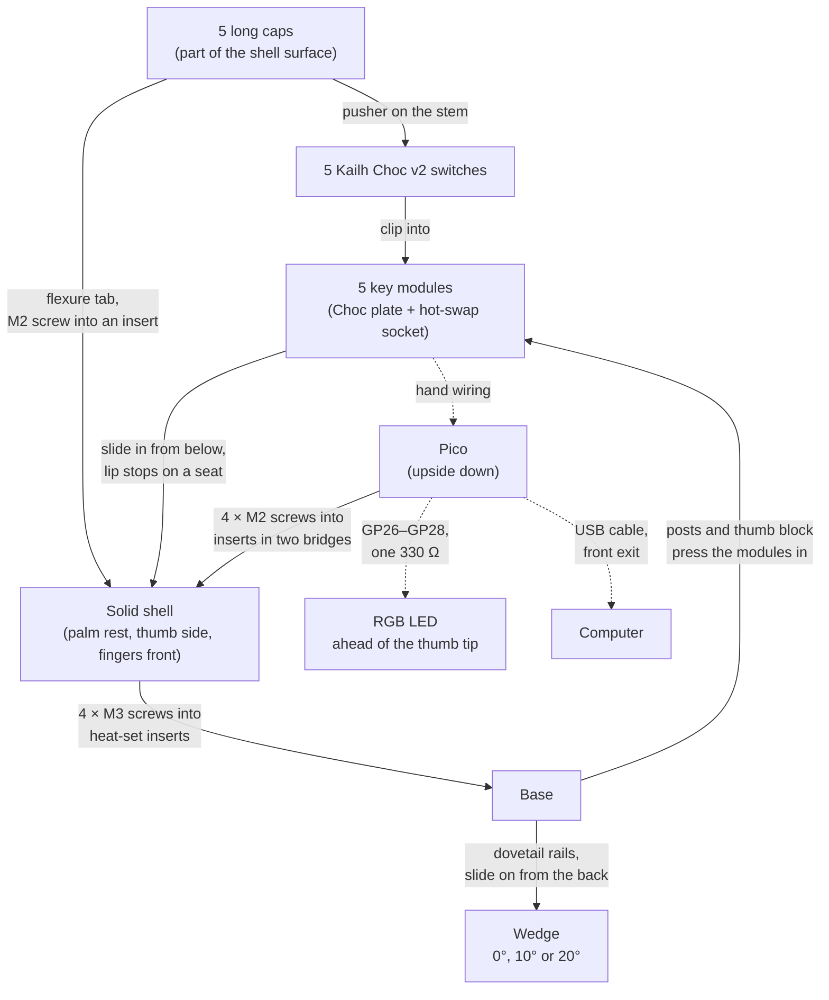
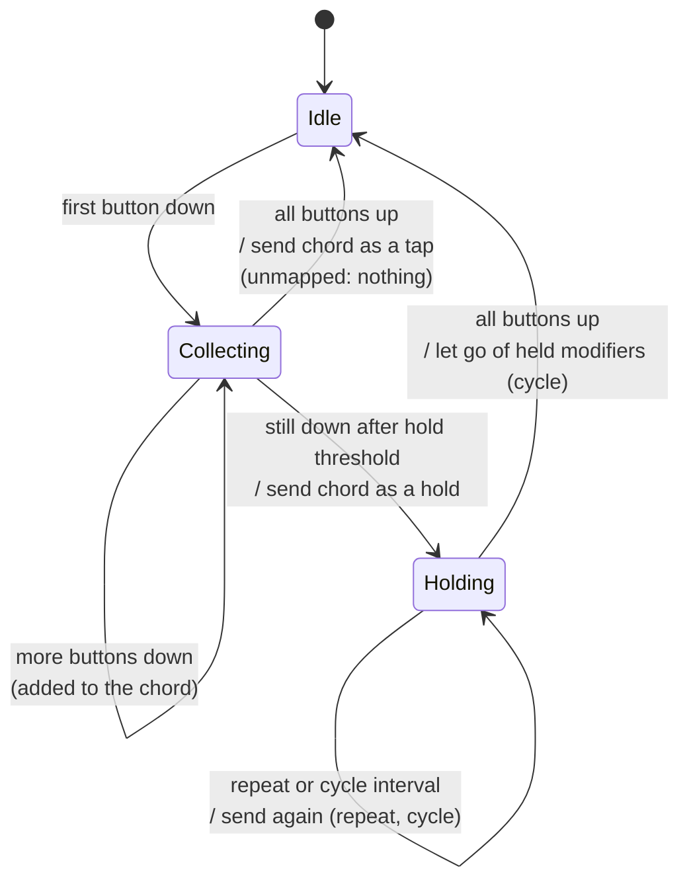

# Architecture

## Overview

handful is a one-handed chording keypad. A Raspberry Pi Pico reads five
buttons, one per finger and one for the thumb, turns single presses and chords
into key presses, and sends them to the computer as a USB keyboard. It holds a
macOS and a Windows mapping set and switches between them with a chord. The
firmware is written in CircuitPython.

## Diagram

### Grip shell

### Chord detection

## Components

- **Raspberry Pi Pico (RP2040)**: the only microcontroller. See
  [0001](decisions/0001-raspberry-pi-pico.md).
- **Five buttons**: one per finger and one for the thumb, giving 31
  combinations. See [0003](decisions/0003-five-buttons.md).
- **Switches**: 12 × 12 mm tactile push buttons on a breadboard for the
  prototype; low-profile Kailh Choc v2 switches in hot-swap sockets, hand-wired in a
  3D-printed shell, for the finished keypad, with a weight chosen per
  finger by testing. See [0007](decisions/0007-switches.md) and
  [0023](decisions/0023-choc-v2-low-profile-switches.md).
- **Enclosure**: a 3D-printed grip shell inspired by the Logitech MX Ergo,
  for the left hand first and mirrorable, tilted by swappable printed wedges
  from 0° to 30° and beyond. See [0011](decisions/0011-grip-shell.md).
- **Shell CAD**: parametric build123d scripts in `cad/` that export STEP, STL
  and preview PNGs for the left or right hand. See
  [0016](decisions/0016-build123d-cad.md) and the [CAD README](../cad/README.md).
- **Hand fit**: the shell is built from the user's own hand measurements,
  kept in a git-ignored `cad/hand.local.toml`, with a medium adult hand from
  ANSUR II for anything not measured. Each digit, the thumb included, rests
  along a cap sized for it. See [0020](decisions/0020-hand-fitted-grip.md).
- **Shell parts**: a solid, mouse-like shell shaped after the MX Ergo: highest
  under the index knuckle, sloping gently down to the desk on the pinky side
  and at the back, with five long caps flush with the surface, each running
  along its digit and bending on a printed flexure at its back end, so the
  whole hand rests on it and just presses. The fingers fan out across the
  front at their relaxed spacing, within the body's width. Five identical key modules (a Choc
  plate with the hot-swap socket below it; the pinky's switch leans 18° out
  to the pinky side to clear its cap)
  slide into the shell from below. The Pico hangs upside down under two
  bridges at the back of the shell, on four M2 screws into inserts, so
  every wire stays in the shell. The base presses the modules into their seats
  with printed posts and a thumb block. Four M3 screws into heat-set inserts
  close the shell, and the
  wedges slide on from the back on dovetail rails. The USB cable stays plugged
  in under the base, leaves at the front and stays level at every tilt. The 5 mm
  RGB indicator LED sits just ahead of the thumb tip, in view. Under the
  wrist and the pinky side of the palm the shell curves up like a rocker, so
  that corner of the hand rests on the desk on every wedge, and each key
  turns 10° about its fingertip so the hand leans onto it. See
  [0017](decisions/0017-grip-shell-parts-and-fastening.md),
  [0024](decisions/0024-pico-hangs-in-the-shell.md),
  [0021](decisions/0021-long-hinged-caps-and-fanned-fingers.md) and
  [0022](decisions/0022-rounded-heel-and-slanted-keys.md).
- **CircuitPython firmware**: reads the buttons, detects chords and sends key
  presses through the built-in `usb_hid` module, with no downloaded libraries.
  See [0013](decisions/0013-circuitpython-with-built-in-modules-only.md).
- **Mapping modes**: a macOS set and a Windows set, toggled by holding all
  five buttons. The onboard LED shows the active mode, and the mode survives a
  power cycle. See [0004](decisions/0004-macos-and-windows-modes.md).
- **RGB indicator LED**: a common-cathode RGB LED on the shell, green in
  macOS mode and blue in Windows mode. See
  [0018](decisions/0018-rgb-indicator-led.md).
- **LED timeout**: both LEDs go dark 5 s (`LED_TIMEOUT_MS`) after the last
  button is released and light again at the next press; 0 keeps them on. See
  [0025](decisions/0025-leds-go-dark-when-idle.md).
- **Chord detection**: every button pressed until all are released forms one
  chord, sent on release. A chord held past the hold threshold (400 ms by
  default) is sent as a hold instead. See
  [0005](decisions/0005-chords-fire-on-release.md).
- **`mappings.py`**: the macOS and Windows mapping sets, kept on the CIRCUITPY
  drive apart from the firmware. Errors are reported with the LED and the
  serial console. See [0006](decisions/0006-mappings-py.md).
- **Default layout**: single presses for push-to-talk, enter, paste, copy and
  backspace; thumb chords for their variants; more fingers for bigger actions;
  I+R opens Mission Control (Task View on Windows) and T+I+M opens search.
  Most actions fire once when held;
  backspace and delete word repeat. Holding all five toggles the mode;
  unmapped chords do nothing, so adding the remaining fingers cancels. See
  [0009](decisions/0009-default-mappings.md) and
  [0025](decisions/0025-cycling-hold-search-and-mission-control.md).
- **Cycling hold**: a mapping marked `"cycle"`, such as `("CMD+TAB",
  "cycle")` for switching apps, keeps its modifiers down while held and
  presses its key again every 500 ms, so the computer's switcher steps on
  until the fingers lift. No default chord uses it. See
  [0025](decisions/0025-cycling-hold-search-and-mission-control.md).
- **Chord usage counts**: with `COUNT_CHORDS = True` in `mappings.py`, the
  Pico counts how often each chord is tapped and held, with no order or
  times, and saves the totals to nvm at most once a minute. Off by default to
  spare the flash. `tools/usage.py` reads and clears them over serial. See
  [0014](decisions/0014-opt-in-chord-usage-counts.md).

## Firmware layout

The firmware lives in `firmware/` and is copied to the CIRCUITPY drive with
`tools/deploy.py`, which downloads nothing, removes files the firmware no
longer has and leaves an existing `mappings.py` in place.

- `code.py`: starts the app on the Pico.
- `mappings.py`: timings (hold, repeat, cycle and LED timeout), the mode
  chord, the `COUNT_CHORDS` switch and both mapping sets. Key names such as
  `CMD+SHIFT+4` are read by the firmware, so the file needs no imports.
- `handful/` chord engine, plain Python with no hardware imports, tested on
  the computer (see Development in the README):
  - `debounce.py`: per-button debounce.
  - `chords.py`: tap, hold, repeat and release events.
  - `keypad.py`: turns events into key presses for the active mode, keeps a
    cycling action's modifiers down until release, and toggles the mode.
  - `usage.py`: the chord usage counts and their saved form.
  - `config.py` and `keys.py`: read and check `mappings.py`, and turn key
    names into USB HID usage IDs. `config.BUTTONS` sets the button order
    everywhere.
  - `app.py`: the main loop. It loads `mappings.py`, feeds button reads to
    the keypad, sends keys, retries the latest report when USB is busy,
    turns the LEDs off when idle, saves the usage counts and answers `usage`
    and `usage reset` on the serial console. It gets the board passed in, so tests run it with a fake board.
  - `hid.py`: builds USB keyboard reports.
- `handful/pico.py` board layer: button pins, the onboard and RGB LEDs, the USB keyboard
  device, serial console input, and the saved mode (byte 0) and usage counts
  (after it) in `microcontroller.nvm`. Tests run it with stand-ins for the
  CircuitPython modules.

`tools/cheatsheet.py` draws the printable [cheat sheet](cheatsheet.svg) and
the README [chords banner](chords.svg) from `mappings.py`, naming each action
after the comment on its line. The drawing code is in `tools/drawings/`. Both
drawings embed Permanent Marker and Coming Soon (Apache-2.0, in
`tools/drawings/fonts/`), cut down to the letters they use, so they look the
same on every computer. A test fails when either drawing is out of date.

`tools/usage.py` asks the Pico for its chord counts over the serial console
and prints them ranked, with the mapped chords not used yet and the unmapped
chords pressed anyway. `--reset` clears them.

The onboard LED is on in macOS mode and off in Windows mode; the RGB LED is
green and blue. Both go dark 5 s after the last button is released and light
again at the next press. When `mappings.py` has a problem, the onboard LED
and the RGB LED in red blink fast together. A held repeating action fires once at the
hold, then after another 400 ms repeats every 50 ms, like a normal keyboard.
A held cycling action opens the switcher at the hold and steps on every
500 ms.

## Interfaces

- Buttons to Pico: each button between its own GPIO and GND, internal
  pull-ups, active low, 5 ms debounce. Thumb GP2, index GP3, middle GP4,
  ring GP5, pinky GP6. See [0008](decisions/0008-direct-gpio-wiring.md).
- RGB indicator LED: blue on GP26 (physical pin 31), green on GP27 (pin 32),
  red on GP28 (pin 34), common leg through one 330 Ω resistor to GND
  (pin 38). Active high, one colour at a time, at most about 4 mA. See
  [0018](decisions/0018-rgb-indicator-led.md).
- Pico to computer: a USB cable carrying a HID keyboard, no drivers needed,
  and CircuitPython's serial console, where the firmware reports problems and
  answers `usage` and `usage reset`.
  The firmware keeps the chord engine and mappings apart from a board layer
  (pins, LED, HID), so a wireless board can be added later. See
  [0012](decisions/0012-wired-usb.md).

## Power

The Pico is powered from the computer over USB. No battery.

## Not decided yet

- Finger rests: a rest along the pinky, like the MX Ergo's, designed after
  the first print shows the hand's fit.
- Switch weight: long caps feel best with light switches; pick them by
  testing a printed shell.
