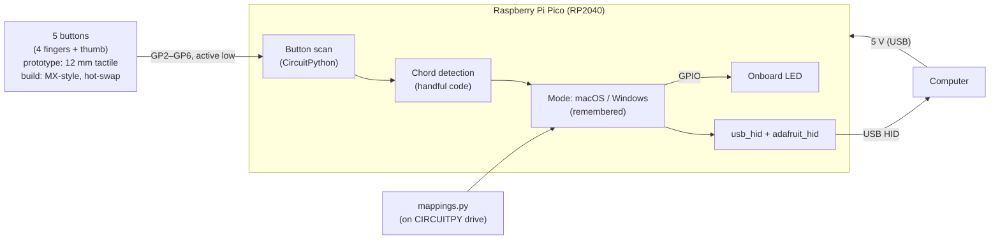
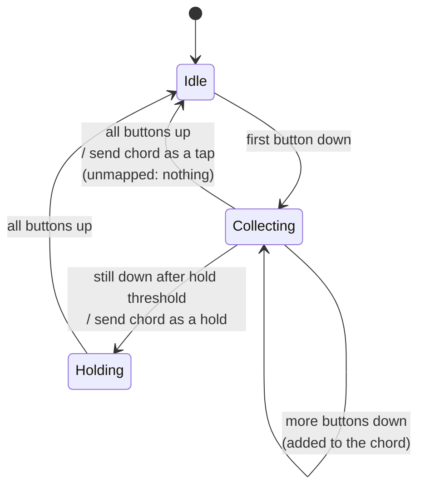

# Architecture

## Overview

handful is a one-handed chording keypad. A Raspberry Pi Pico reads five
buttons, one per finger and one for the thumb, turns single presses and chords
into key presses, and sends them to the computer as a USB keyboard. It holds a
macOS and a Windows mapping set and switches between them with a chord. The
firmware is written in CircuitPython.

## Diagram

### Chord detection

## Components

- **Raspberry Pi Pico (RP2040)**: the only microcontroller. See
  [0001](decisions/0001-raspberry-pi-pico.md).
- **Five buttons**: one per finger and one for the thumb, giving 31
  combinations. See [0003](decisions/0003-five-buttons.md).
- **Switches**: 12 × 12 mm tactile push buttons on a breadboard for the
  prototype; MX-style switches in hot-swap sockets, hand-wired in a
  3D-printed shell, for the finished keypad, with a weight chosen per
  finger by testing. See [0007](decisions/0007-switches.md) and
  [0010](decisions/0010-mx-style-switches.md).
- **Enclosure**: a 3D-printed grip shell inspired by the Logitech MX Ergo,
  for the left hand first and mirrorable, tilted by swappable printed wedges
  from 0° to 30° and beyond. See [0011](decisions/0011-grip-shell.md).
- **CircuitPython firmware**: reads the buttons, detects chords and sends key
  presses with `usb_hid` and `adafruit_hid`. See
  [0002](decisions/0002-circuitpython-firmware.md).
- **Mapping modes**: a macOS set and a Windows set, toggled by holding all
  five buttons. The onboard LED shows the active mode, and the mode survives a
  power cycle. See [0004](decisions/0004-macos-and-windows-modes.md).
- **Chord detection**: every button pressed until all are released forms one
  chord, sent on release. A chord held past the hold threshold (400 ms by
  default) is sent as a hold instead. See
  [0005](decisions/0005-chords-fire-on-release.md).
- **`mappings.py`**: the macOS and Windows mapping sets, kept on the CIRCUITPY
  drive apart from the firmware. Errors are reported with the LED and the
  serial console. See [0006](decisions/0006-mappings-py.md).
- **Default layout**: single presses for push-to-talk, enter, paste, copy and
  backspace; thumb chords for their variants; more fingers for bigger actions.
  Most actions fire once when held; backspace and delete word repeat. Holding
  all five toggles the mode; unmapped chords do nothing, so adding the
  remaining fingers cancels. See [0009](decisions/0009-default-mappings.md).

## Interfaces

- Buttons to Pico: each button between its own GPIO and GND, internal
  pull-ups, active low, 5 ms debounce. Thumb GP2, index GP3, middle GP4,
  ring GP5, pinky GP6. See [0008](decisions/0008-direct-gpio-wiring.md).
- Pico to computer: a USB cable carrying a HID keyboard, no drivers needed.
  The firmware keeps the chord engine and mappings apart from a board layer
  (pins, LED, HID), so a wireless board can be added later. See
  [0012](decisions/0012-wired-usb.md).

## Power

The Pico is powered from the computer over USB. No battery.

## Not decided yet

- CAD tool for the shell, chosen after the prototype.
